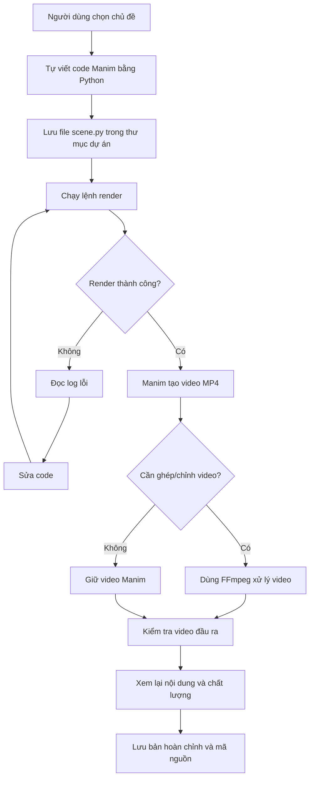

# Thiết kế bản thử nghiệm: Pipeline tạo video thuật toán bằng Manim

> **Vai trò của tài liệu này:** Hướng dẫn triển khai MVP chi tiết — bổ sung cho `ke-hoach.md`.
> Nguồn sự thật chính thức là [`ke-hoach.md`](./ke-hoach.md).
>
> **⚠️ Lưu ý về Manim:** Project đã chốt dùng **ManimGL** (`from manimlib import *`).
> Các đoạn ví dụ trong tài liệu này dùng ManimCE (`from manim import *`) chỉ để minh họa quy trình,
> **không dùng thực tế**. Khi viết code thật, dùng ManimGL và tham khảo `integral_tutorial.py`.

**Phiên bản:** MVP 0.1  
**Nền tảng mục tiêu:** Windows 11, chạy cục bộ  
**Mục tiêu:** Kiểm chứng quy trình tạo và xuất video hoạt ảnh về thuật toán/lập trình trước khi tích hợp Gemini API.

---

# Phần I — Luồng hoạt động của hệ thống bản thử nghiệm

## 1. Mục tiêu và phạm vi

Bản thử nghiệm đầu tiên tập trung kiểm chứng các thành phần chạy local:

- Người dùng tự viết hoặc dán code Manim vào file Python.
- Chạy Manim để render hoạt ảnh.
- Dùng FFmpeg ghép/chuyển đổi video khi cần.
- Lưu video đầu ra và các file nguồn để có thể chỉnh sửa, render lại.
- Chưa gọi Gemini API.
- Chưa tích hợp TTS, tạo phụ đề tự động, giao diện đồ họa hoặc tự đăng YouTube.

**Tiêu chí hoàn thành:** có thể nhập code Manim, chạy một lệnh, tạo được file MP4 xem được trên máy tính và biết rõ file đầu ra nằm ở đâu.

## 2. Luồng tổng quát



## 3. Vai trò của từng thành phần

| Thành phần | Vai trò trong bản thử nghiệm |
|---|---|
| Người dùng | Chọn chủ đề, viết/sửa code và duyệt video |
| Python | Chứa mô tả cảnh và logic hoạt ảnh |
| ManimGL hoặc Manim Community Edition (ManimCE) | Render code thành video |
| FFmpeg | Ghép video, chuyển định dạng hoặc xử lý âm thanh khi cần |
| Thư mục dự án | Lưu code, log và video đầu ra |

### Lưu ý quan trọng về ManimGL và ManimCE

Repository `shihabshahrier/manim-coding-skill` được định hướng cho **ManimGL**. ManimGL và Manim Community Edition (ManimCE) có API và cách chạy khác nhau. Không nên dùng code hoặc lệnh của bản này cho bản kia mà chưa kiểm tra.

Trước khi bắt đầu, hãy chọn rõ một trong hai:

- **Hướng A — Bám sát `manim-coding-skill`:** dùng ManimGL và theo đúng hướng dẫn cài đặt của repository.
- **Hướng B — Dùng ManimCE:** phù hợp nếu bạn đã quen hoặc đã cài ManimCE, nhưng phải điều chỉnh code/prompt của skill cho tương thích.

Bản hướng dẫn dưới đây dùng lệnh theo **ManimCE** để minh họa vì cách cài đặt và kiểm tra tương đối dễ tiếp cận. Nếu mục tiêu là kiểm thử trực tiếp skill mà không sửa đổi, hãy chọn ManimGL và thay lệnh theo README chính thức của repository. Không cài cả hai rồi mặc định chúng tương thích với nhau.

## 4. Cấu trúc thư mục MVP

Tạo một thư mục riêng để tránh ảnh hưởng các dự án hiện tại:

```text
coding-video-factory/
├── projects/
│   └── binary_search/
│       ├── scene.py
│       ├── README.md
│       └── output/
├── scripts/
│   └── render.ps1
├── .gitignore
└── requirements-notes.md
```

Trong giai đoạn đầu, thư mục `output/` có thể chưa được Manim tự động dùng làm nơi lưu video. Manim mặc định tạo kết quả bên trong thư mục `media/`; sau khi render, có thể sao chép video đã chọn sang `projects/binary_search/output/`.

## 5. Quy trình chạy cho mỗi video

1. Tạo thư mục dự án theo tên chủ đề.
2. Viết code scene vào `scene.py`.
3. Chạy lệnh render với tên scene.
4. Đọc thông báo lỗi nếu render thất bại.
5. Sửa code và chạy lại.
6. Mở video MP4, kiểm tra kiến thức, bố cục, chữ và tốc độ.
7. Sao chép bản được duyệt vào thư mục `output/`.
8. Lưu lại code nguồn để có thể chỉnh sửa về sau.

## 6. Điều kiện để chuyển sang giai đoạn kế tiếp

Chỉ tích hợp Gemini API khi đã có thể:

- Cài và chạy được phiên bản Manim đã chọn.
- Render thành công ít nhất một video ngắn.
- Tìm được file MP4 đầu ra và mở xem bình thường.
- Đọc được log lỗi cơ bản và sửa một lỗi code đơn giản.
- Phân biệt được code nguồn, file render trung gian và video cuối.

---

# Phần II — Cách triển khai bản thử nghiệm trên Windows

## 1. Chuẩn bị công cụ

Cần có:

- Windows 11.
- Python tương thích với phiên bản Manim đã chọn.
- Git (không bắt buộc cho render, nhưng hữu ích để quản lý mã nguồn).
- FFmpeg nếu cần xử lý/ghép video.
- LaTeX nếu dùng các công thức toán học mà phiên bản Manim yêu cầu.

**Đừng cài đặt theo hướng dẫn ManimCE rồi chạy skill vốn nhắm đến ManimGL.** Hãy quyết định phiên bản trước khi cài.

### Kiểm tra các công cụ có sẵn

Mở PowerShell:

```powershell
python --version
git --version
ffmpeg -version
```

Nếu lệnh nào báo không tìm thấy, công cụ đó chưa được cài hoặc chưa nằm trong `PATH`. Git không bắt buộc ở MVP; FFmpeg chỉ cần khi bạn xử lý video ngoài khả năng render cơ bản của Manim.

## 2. Tạo thư mục làm việc

Ví dụ dùng ổ C:

```powershell
mkdir C:\personal_kyvu\CODE\coding-video-factory
cd C:\personal_kyvu\CODE\coding-video-factory

mkdir projects
mkdir projects\binary_search
mkdir projects\binary_search\output
```

Bạn có thể thay đường dẫn theo vị trí lưu code hiện tại.

## 3. Chọn và cài Manim

### Phương án A — ManimCE (ví dụ triển khai)

Tạo môi trường ảo:

```powershell
python -m venv .venv
.\.venv\Scripts\Activate.ps1
python -m pip install --upgrade pip
python -m pip install manim
```

Kiểm tra:

```powershell
manim --version
```

Nếu PowerShell chặn việc kích hoạt môi trường ảo, có thể gọi trực tiếp executable trong `.venv` hoặc điều chỉnh chính sách chỉ cho phiên hiện tại nếu bạn hiểu rõ thay đổi. Không cần tắt chính sách bảo mật toàn hệ thống.

### Phương án B — ManimGL để bám sát skill

Đọc README và hướng dẫn cài đặt hiện hành của repository:

- https://github.com/shihabshahrier/manim-coding-skill
- https://github.com/3b1b/manim

Cài đúng ManimGL cùng các phụ thuộc theo hướng dẫn chính thức, sau đó kiểm tra lệnh và phiên bản thực tế. Không dùng lệnh render ManimCE cho dự án ManimGL nếu README của phiên bản đã cài chỉ định lệnh khác.

> Nếu mục tiêu ưu tiên là dùng skill nguyên bản, hãy chọn phương án B. Nếu mục tiêu trước mắt chỉ là chứng minh quy trình “code → render → MP4”, phương án A là ví dụ MVP độc lập; cần điều chỉnh sau nếu chuyển sang ManimGL.

## 4. Tạo file thử nghiệm `scene.py`

Ví dụ dưới đây dành **riêng cho ManimCE**. Nội dung minh họa Binary Search, không cần Gemini API.

Tạo file `projects/binary_search/scene.py`:

```python
from manim import *


class BinarySearchDemo(Scene):
    def construct(self):
        title = Text("Binary Search", font_size=40)
        subtitle = Text(
            "Tim kiem nhi phan tren mang da sap xep",
            font_size=22,
        )
        subtitle.next_to(title, DOWN, buff=0.25)

        values = [2, 5, 8, 12, 16, 23, 38]
        target = 16

        cells = VGroup()
        labels = VGroup()

        for value in values:
            square = Square(side_length=0.75)
            label = Text(str(value), font_size=24)
            label.move_to(square.get_center())
            cells.add(square)
            labels.add(label)

        row = VGroup(*[
            VGroup(cells[i], labels[i]) for i in range(len(values))
        ]).arrange(RIGHT, buff=0.08)

        row.shift(DOWN * 0.4)

        status = Text("Can tim gia tri 16", font_size=26)
        status.next_to(row, DOWN, buff=0.6)

        self.play(Write(title), FadeIn(subtitle))
        self.play(Create(cells), FadeIn(labels))
        self.play(Write(status))
        self.wait(0.8)

        left, right = 0, len(values) - 1

        while left <= right:
            mid = (left + right) // 2
            highlight = cells[mid].copy().set_fill(YELLOW, opacity=0.65)

            self.play(FadeIn(highlight))
            self.play(
                Indicate(labels[mid], color=YELLOW),
                run_time=0.5,
            )
            self.play(FadeOut(highlight))

            if values[mid] == target:
                found = Text("Da tim thay 16!", color=GREEN, font_size=30)
                found.next_to(status, DOWN, buff=0.35)
                self.play(Transform(status, found))
                break

            if values[mid] < target:
                left = mid + 1
            else:
                right = mid - 1

        self.wait(2)
```

Ví dụ này chỉ là scene minh họa ban đầu. Nó chưa phải template sản xuất hoàn chỉnh; về sau cần thêm mũi tên `left`, `mid`, `right`, giải thích vì sao loại bỏ nửa mảng và hiển thị độ phức tạp `O(log n)`.

Nếu font hoặc ký tự tiếng Việt hiển thị không đúng, hãy kiểm tra font trên máy hoặc dùng nội dung không dấu cho lần kiểm thử đầu tiên.

## 5. Render video

Từ thư mục gốc `coding-video-factory`, kích hoạt môi trường ảo nếu chưa kích hoạt:

```powershell
.\.venv\Scripts\Activate.ps1
```

Chạy lệnh render chất lượng thấp để thử nhanh:

```powershell
manim -pql projects\binary_search\scene.py BinarySearchDemo
```

Giải thích:

- `-p`: mở video sau khi render nếu môi trường hỗ trợ.
- `-q`: chọn chất lượng.
- `l`: mức thấp, phù hợp để thử nhanh.
- `BinarySearchDemo`: tên class scene trong file.

Nếu render thành công, ManimCE thường lưu video trong cây thư mục `media\videos\...`. Đọc đường dẫn được in ra ở cuối lệnh thay vì đoán tên file.

Khi đã ổn, render bản chất lượng cao hơn:

```powershell
manim -pqh projects\binary_search\scene.py BinarySearchDemo
```

## 6. Kiểm tra file đầu ra

Tìm file MP4 mới nhất:

```powershell
Get-ChildItem -Path .\media -Filter *.mp4 -Recurse |
    Sort-Object LastWriteTime -Descending |
    Select-Object -First 5 FullName, Length, LastWriteTime
```

Nếu muốn dùng FFmpeg để xem thông tin video:

```powershell
ffprobe -v error -show_entries format=duration,size -of default=noprint_wrappers=1 "DUONG_DAN_VIDEO.mp4"
```

Thay `DUONG_DAN_VIDEO.mp4` bằng đường dẫn thật của file đã render.

Sau khi xem và duyệt, sao chép file sang thư mục đầu ra. Ví dụ:

```powershell
Copy-Item "DUONG_DAN_VIDEO.mp4" ".\projects\binary_search\output\binary_search.mp4"
```

Không nhập nguyên văn chuỗi `DUONG_DAN_VIDEO.mp4`; đó là chỗ giữ chỗ cần thay bằng đường dẫn thật.

## 7. Tạo script chạy nhanh (tùy chọn)

Sau khi lệnh render thủ công hoạt động, tạo file `scripts/render.ps1`:

```powershell
param(
    [string]$SceneFile = "projects\binary_search\scene.py",
    [string]$SceneName = "BinarySearchDemo"
)

$ErrorActionPreference = "Stop"

if (-not (Test-Path $SceneFile)) {
    throw "Khong tim thay file scene: $SceneFile"
}

manim -pql $SceneFile $SceneName

if ($LASTEXITCODE -ne 0) {
    throw "Manim render that bai. Hay kiem tra log phia tren."
}
```

Chạy từ thư mục gốc:

```powershell
.\scripts\render.ps1
```

Hoặc truyền scene khác:

```powershell
.\scripts\render.ps1 -SceneFile "projects\binary_search\scene.py" -SceneName "BinarySearchDemo"
```

Script trên là ví dụ cho ManimCE. Nếu chọn ManimGL, thay lệnh render theo phiên bản đã cài và thử nghiệm riêng.

## 8. Xử lý lỗi phổ biến

| Triệu chứng | Cách kiểm tra |
|---|---|
| `manim` không được nhận diện | Kích hoạt `.venv`, kiểm tra `python -m pip show manim` và `PATH` |
| Không tìm thấy scene | Kiểm tra đường dẫn file và tên class, bao gồm chữ hoa/chữ thường |
| Code báo thiếu module `manim` | Đảm bảo cài thư viện trong đúng môi trường Python đang chạy |
| Không tìm thấy FFmpeg | Chạy `ffmpeg -version`, kiểm tra cài đặt và `PATH` |
| Công thức LaTeX lỗi | Kiểm tra LaTeX và cấu hình theo phiên bản Manim |
| Video có nhưng chữ bị tràn | Giảm font, rút gọn nội dung hoặc sắp xếp lại đối tượng |
| Skill sinh code không chạy | Kiểm tra code có đúng ManimGL hay ManimCE; không trộn hai API |

## 9. Checklist hoàn thành MVP

- [ ] Chọn rõ ManimGL hoặc ManimCE.
- [ ] Chạy được lệnh kiểm tra phiên bản.
- [ ] Tạo file `scene.py`.
- [ ] Render thành công một video Binary Search.
- [ ] Tìm và mở được file MP4.
- [ ] Sửa được ít nhất một lỗi render đơn giản.
- [ ] Lưu video đã duyệt vào `output/`.
- [ ] Chưa gọi Gemini API trong giai đoạn này.
- [ ] Ghi lại lệnh cài đặt và lệnh render đã thực sự hoạt động trên máy.

## 10. Phạm vi sau MVP

Khi phần render thủ công đã ổn định, triển khai lần lượt:

1. Gọi Gemini API để tạo `outline.md` và `script_vi.md`.
2. Yêu cầu Gemini tạo `scene_plan.md`.
3. Sinh code scene theo đúng phiên bản Manim đã chọn.
4. Chạy kiểm tra và render từng scene, gửi lỗi về Gemini nếu cần.
5. Tích hợp VieNeu-TTS, căn thời lượng audio và tạo phụ đề.
6. Ghép video hoàn chỉnh bằng FFmpeg.
7. Thêm giao diện và tính năng đăng YouTube sau cùng.

**Nguyên tắc:** mỗi giai đoạn phải tạo được một đầu ra kiểm chứng được trước khi thêm module tiếp theo. Điều đó giúp giảm số lỗi cần debug cùng lúc và tránh tiêu tốn hạn mức Gemini cho những lỗi môi trường vốn có thể phát hiện bằng một lần chạy thử thủ công.
